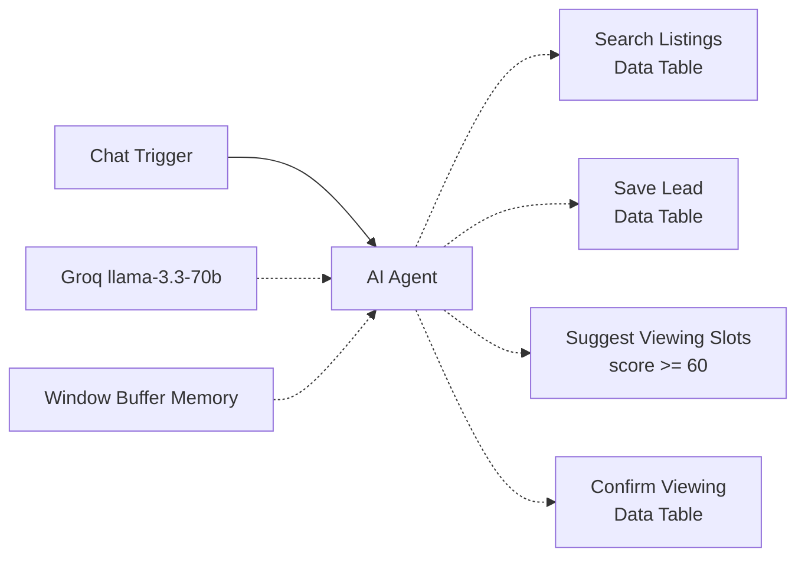

# AI Real Estate Assistant – n8n

A chat assistant that answers property questions from n8n Data Tables (easily swappable for Google Sheets), qualifies leads (score 0–100), and books viewing slots for good leads. Replies in English or German. Built with n8n, an AI Agent and Groq (free tier).

## What it does
- Searches listings (city, rooms, price) from the `Listings` data table – never invents properties.
- Asks one question at a time: buy/rent, budget, timing, financing, contact.
- Saves each lead with a 0–100 score to a `Leads` sheet.
- Score ≥ 60 → offers 3 viewing slots and writes the chosen one back to the lead.
- Keeps conversation context with window buffer memory.

## Flow

## Tools
n8n 2.x · AI Agent node · Groq Chat Model · Window Buffer Memory · n8n Data Tables (Google Sheets can easily replace them) · Code Tool

## Setup
1. In n8n create data tables `Listings` and `Leads` (columns = CSV headers) and import `listings.csv`.
2. Import `workflow.json`.
3. Add a Groq credential; pick the tables in the 3 Data Table tool nodes.
4. Open the chat and test.

No OAuth needed. Turkish steps: [KURULUM-DATATABLES.md](KURULUM-DATATABLES.md). Google Sheets variant: [KURULUM.md](KURULUM.md) (swap the 3 nodes for Google Sheets Tool nodes). All data is fictional.

## Security notes (demo scope)
- Data tables store typed values, so user text is never evaluated as a formula (relevant if you swap in Google Sheets: use RAW cell format).
- Leads are upserted by email and the score ≥ 60 gate is enforced by the agent prompt. Fine for a demo; for production, verify the email (one-time code) and move the score check into a Code node.

## Screenshots
- `docs/canvas.png` – workflow canvas
- `docs/chat.png` – chat with listing results
- `docs/leads-sheet.png` – Leads data table with score and viewing slot
