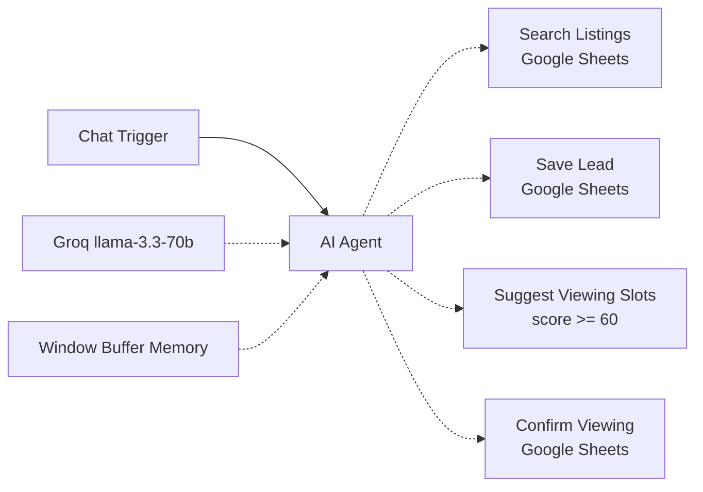

# AI Real Estate Assistant – n8n

A chat assistant that answers property questions from a Google Sheet, qualifies leads (score 0–100), and books viewing slots for good leads. Replies in English or German. Built with n8n, an AI Agent and Groq (free tier).

## What it does
- Searches listings (city, rooms, price) from a Google Sheet – never invents properties.
- Asks one question at a time: buy/rent, budget, timing, financing, contact.
- Saves each lead with a 0–100 score to a `Leads` sheet.
- Score ≥ 60 → offers 3 viewing slots and writes the chosen one back to the lead.
- Keeps conversation context with window buffer memory.

## Flow

## Tools
n8n 2.x · AI Agent node · Groq Chat Model · Window Buffer Memory · Google Sheets Tool · Code Tool

## Setup
1. Import `listings.csv` and `leads.csv` into a Google Sheet (tabs `Listings`, `Leads`).
2. In n8n: import `workflow.json`.
3. Add a Groq credential and a Google Sheets OAuth2 credential, then paste your Sheet ID in the 3 Sheets tool nodes.
4. Open the chat and test.

Detailed (Turkish) steps: [KURULUM.md](KURULUM.md). All data is fictional.

## Security notes (demo scope)
- Sheet writes use RAW cell format, so user text is never evaluated as a formula.
- Leads are upserted by email and the score ≥ 60 gate is enforced by the agent prompt. Fine for a demo; for production, verify the email (one-time code) and move the score check into a Code node.

## Screenshots
- `docs/canvas.png` – workflow canvas
- `docs/chat.png` – chat with listing results
- `docs/leads-sheet.png` – Leads sheet with score and viewing slot
